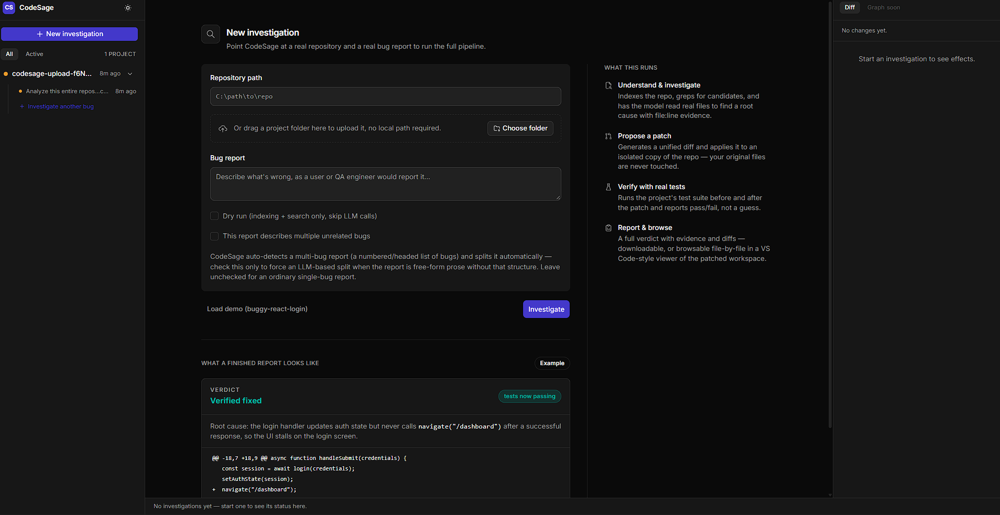

# CodeSage

<div align="center">
  
</div>

## About The Project

CodeSage is an autonomous AI Software Engineer: a full-stack debugging agent that inspects a real codebase, investigates a reported bug using actual file evidence, proposes a verified code patch, and runs the project's own test suite before and after the fix. Built with React and Express, it gives every verdict — **verified fixed**, **tests still failing**, **inconclusive** — backed by real exit codes and real diffs, never a guess.

Unlike a chatbot that returns code snippets, CodeSage reads the files it cites, applies its patch only to an isolated copy of your repository, and proves the fix by actually running your tests. If it can't verify something, it says so.

### Key Features

- **Real Repository Understanding** — indexes the project, detects its stack/test command, and greps for evidence before reading a single file
- **Agentic Investigation** — a genuine multi-turn tool-calling loop (`read_file` / `search_code`) that must cite `file:line` evidence before concluding
- **Multi-Bug Orchestration** — splits a combined bug report into independent sub-investigations, runs them sequentially against a single accumulating workspace, and regression-tests after every fix
- **Verified Patches, Not Claims** — unified diffs applied via `git apply` (with a text-patch fallback) inside an isolated workspace copy; your original repository is never touched
- **Real Before/After Testing** — runs the project's actual test command and compares real pass/fail counts, not an LLM's opinion
- **Multi-Provider LLM Fallback** — Anthropic, Groq, and OpenRouter behind one interface; automatically falls back to the next backend on a rate limit
- **Folder Upload + VS Code-Style Viewer** — drag-and-drop a project folder, then browse the patched workspace file-by-file with real syntax highlighting
- **Modern UI** — a dark, OpenBot-derived design system with a 3-pane investigation console

## Built With

### Frontend
- [React](https://reactjs.org/) - UI library
- [Vite](https://vitejs.dev/) - Build tool and dev server
- [Tailwind CSS](https://tailwindcss.com/) - Utility-first CSS framework
- [Prism](https://prismjs.com/) - Syntax highlighting for the diff/code viewer

### Backend
- [Express](https://expressjs.com/) - Node.js web framework
- [TypeScript](https://www.typescriptlang.org/) - Typed core pipeline and server
- [simple-git](https://git-scm.com/) (via the system `git` binary) - Patch application and workspace isolation
- [Anthropic SDK](https://github.com/anthropics/anthropic-sdk-typescript) / [OpenAI SDK](https://github.com/openai/openai-node) - LLM provider clients (Claude, Groq, OpenRouter)
- [Multer](https://github.com/expressjs/multer) - Folder upload handling
- [Vitest](https://vitest.dev/) - Test runner for the core pipeline

## Prerequisites

Before you begin, ensure you have the following installed:

- **Node.js** (v18.17 or higher)
  ```bash
  node --version
  ```

- **npm** (v9 or higher)
  ```bash
  npm --version
  ```

- **Git** (required for patch application and workspace isolation)
  ```bash
  git --version
  ```

## Installation

### 1. Clone the Repository

```bash
git clone https://github.com/yourusername/codesage.git
cd codesage
```

### 2. Core Pipeline Setup

```bash
# Install dependencies
npm install

# Create environment file
cp .env.example .env

# Add at least one LLM provider key to .env:
# GROQ_API_KEY=...        (or)
# ANTHROPIC_API_KEY=...   (or)
# OPENROUTER_API_KEY=...

# Build the core pipeline + CLI
npm run build
```

### 3. Server Setup

```bash
cd server
npm install
cd ..
```

### 4. Web UI Setup

```bash
cd web
npm install
cd ..
```

### 5. Run the Application

**One command (recommended):**
```bash
bash scripts/demo.sh
```
This starts the API server (`http://localhost:8787`) and the web UI (`http://localhost:5173`) together.

**Or run them separately:**

**Terminal 1 - Backend:**
```bash
cd server
npm start
```
Backend will run on `http://localhost:8787`

**Terminal 2 - Frontend:**
```bash
cd web
npm run dev
```
Frontend will run on `http://localhost:5173`

Visit `http://localhost:5173` in your browser to see the application.

## Usage

### New Investigation
1. **Point at a repository** — type a local path, or drag-and-drop a project folder to upload it
2. **Describe the bug** — write it the way a user or QA engineer would report it
3. **Run** — click **Investigate** (or check **Dry run** to see indexing + search only, with no LLM calls)

### Reading a Result
1. **Verdict** — the headline status (`Verified fixed`, `Tests still failing`, `Inconclusive`, …), always derived from a real exit code
2. **Root cause** — the model's explanation, with `file:line` evidence it actually read
3. **Diff** — the exact patch applied, viewable in the Effects panel or the full-page VS Code-style code viewer
4. **Test results** — real before/after pass/fail counts from the project's own test command

### Multi-Bug Reports
Paste a bug report describing several unrelated issues (e.g. a `BUG_REPORT.md` with numbered sections), or check **"This report describes multiple unrelated bugs"** to force it. CodeSage splits it into independent sub-investigations, fixes what it can, and produces one consolidated report with a regression check after every patch.

### API Endpoints

The backend provides the following REST API endpoints:

- `GET /api/health` - Health check + whether an LLM provider is configured
- `GET /api/example` - The bundled demo repo path + bug report
- `POST /api/jobs` - Start an investigation (single- or multi-bug, auto-detected)
- `GET /api/jobs/:id` - Poll a job's live status, events, and report
- `GET /api/jobs/:id/report.md` - The generated engineering report as Markdown
- `POST /api/upload` - Upload a project folder for investigation
- `GET /api/jobs/:id/files` - List the patched workspace's file tree
- `GET /api/jobs/:id/files/*path` - Read one file's content from the patched workspace
- `GET /api/jobs/:id/download` - Download the patched workspace as a `.zip`

## Project Structure

```
codesage/
├── src/                        # Core pipeline (shared by CLI and server)
│   ├── pipeline.ts            # Single-bug pipeline
│   ├── multiPipeline.ts       # Multi-bug orchestrator
│   ├── cli.ts                 # CLI entry point
│   ├── repo/                  # Indexing, symbol extraction, stack detection
│   ├── search/                # Keyword extraction + grep-style search
│   ├── llm/                   # Provider-agnostic agentic loop, patch generation,
│   │                          #   Anthropic / Groq / OpenRouter / fallback providers
│   ├── patch/                 # Unified-diff repair + application (git apply + fallback)
│   ├── workspace/              # Isolated workspace copy management
│   ├── testRunner/            # Dependency install + before/after test execution
│   └── report/                 # Markdown/JSON engineering report generation
├── server/                     # Express API
│   └── src/
│       ├── index.ts            # Routes
│       ├── jobs.ts             # Async job store + disk persistence
│       ├── upload.ts           # Folder upload handling
│       ├── files.ts            # Patched-workspace file browser + zip download
│       └── projectStore.ts     # Durable storage of fixed workspaces
├── web/                         # React frontend
│   └── src/
│       ├── components/console/ # Investigation console (sidebar, verdict, diffs, stages)
│       ├── components/codeviewer/ # VS Code-style patched-workspace browser
│       ├── components/ui/      # Design-system primitives
│       └── theme.css           # Dark theme tokens
├── examples/                    # Deliberately buggy demo fixtures
│   └── buggy-react-login/
├── tests/                       # Vitest unit tests for the core pipeline
├── docs/
│   ├── ARCHITECTURE.md
│   └── SUBMISSION.md
├── scripts/
│   └── demo.sh                  # Starts server + web together
├── .env.example                 # Environment variable reference
└── README.md                    # This file
```

## Features in Detail

### The Investigation Loop

**Agentic Tool-Calling**
- The model is given `read_file` and `search_code` tools and must use them before concluding
- Every claim in the root cause must cite a `file:line` the model actually read
- A configurable iteration budget (default 12) bounds the loop; it degrades honestly to "inconclusive" rather than guessing if it runs out

**Evidence-First Design**
- Keyword search over the bug report surfaces candidate files before the model reads anything
- The model's final verdict is a structured JSON block (root cause, evidence, files to patch, confidence) — parsed leniently, rejected honestly if malformed

### Patch Generation & Application

**Unified Diff Patches**
- Generated from the model, based on the real current file contents it was shown
- Hunk headers are auto-repaired from real file content (smaller models frequently get line counts/positions wrong)
- Applied via `git apply` first, with a `diff`-package text-patcher fallback
- One automatic retry with the exact application error fed back to the model, for a genuinely recoverable mismatch

**Isolated Workspace**
- Every patch is applied to a fresh filesystem copy with its own local git repo
- The original repository is never mutated
- A durable copy of the patched workspace is kept for the file browser and `.zip` download

### Verification

**Real Before/After Testing**
- Auto-detects the project's test command (`npm test`, `pytest`, Node's built-in test runner, etc.)
- Runs it in the isolated workspace both before and after the patch
- Compares real pass/fail counts and exit codes — the verdict is computed, never asserted

**Honest Verification States**
- `verified-fixed` — tests failed before, passed after (a real flip)
- `tests-still-failing` — patch applied, but tests didn't improve
- `patch-did-not-apply` — the diff couldn't be applied, with the exact engine error
- `inconclusive` — no clear signal (e.g. the model never reached a structured verdict)
- `no-tests-detected` — no test command found for the project
- `dry-run-no-llm` — indexing/search only, no LLM configured or requested

### Multi-Bug Orchestration

- Splits a combined report structurally (real `## Bug N` headings or a genuine numbered list) with zero LLM calls when possible, falling back to an LLM split only for free-form prose
- Rejects a split that looks like a generic debugging procedure rather than real distinct bugs
- Runs each sub-bug sequentially against one shared, accumulating workspace
- Re-runs the full test suite after every applied fix, as a real regression check
- A failed/inconclusive sub-bug is rolled back and the batch continues — one bad sub-investigation never derails the rest
- Produces one consolidated report: per-bug verdicts, files touched, baseline vs. final regression results

## Deployment

CodeSage's backend runs real `git`, `npm`, and test-runner subprocesses and writes isolated workspace copies to disk — it needs a host that supports persistent processes and a filesystem, not a serverless/edge runtime.

### Frontend (Vercel, Netlify, or any static host)

1. Push code to GitHub
2. Import the repository, set the project root to `web`
3. Set the environment variable:
   ```
   VITE_SERVER_URL=https://your-backend-url
   ```
4. Deploy

### Backend (Railway, Render, Fly.io, or a VPS)

1. Push code to GitHub
2. Create a new service, set the root directory to `server`
3. Configure environment variables (see `.env.example`):
   ```
   GROQ_API_KEY=...
   GROQ_API_KEY_2=...        # optional secondary key for fallback
   OPENROUTER_API_KEY=...    # optional third fallback
   ANTHROPIC_API_KEY=...     # optional, alternative provider
   ```
4. Deploy

## Environment Variables

### Root (`.env`)
```env
# Set at least one LLM provider key
ANTHROPIC_API_KEY=
GROQ_API_KEY=
GROQ_API_KEY_2=            # optional fallback for GROQ_API_KEY
OPENROUTER_API_KEY=        # optional second fallback
OPENROUTER_MODEL=          # optional, defaults to openai/gpt-oss-20b

LLM_PROVIDER=              # optional override: "anthropic" | "groq"
CODESAGE_MODEL=            # optional override of the default model
CODESAGE_MAX_ITERATIONS=   # optional, defaults to 12
CODESAGE_TEST_TIMEOUT_MS=  # optional, defaults to 120000
```

### Server (inherits the same `.env`)
```env
CODESAGE_SERVER_PORT=8787  # optional, defaults to 8787
```

### Web (`web/vite.config.ts` dev proxy, or `VITE_SERVER_URL` in production)
```env
VITE_SERVER_URL=http://localhost:8787
```

## Contributing

Contributions are what make the open source community such an amazing place to learn, inspire, and create. Any contributions you make are **greatly appreciated**.

1. Fork the Project
2. Create your Feature Branch (`git checkout -b feature/AmazingFeature`)
3. Commit your Changes (`git commit -m 'Add some AmazingFeature'`)
4. Push to the Branch (`git push origin feature/AmazingFeature`)
5. Open a Pull Request

## License

Distributed under the MIT License. See `LICENSE` for more information.
